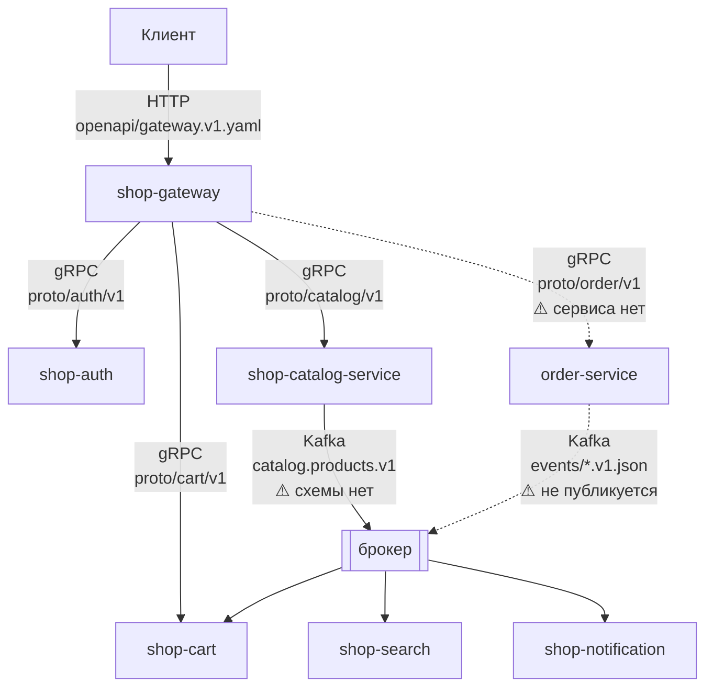
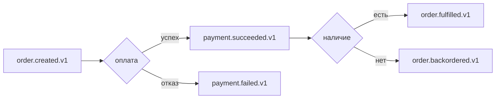

# shop-contracts

Контракты межсервисного взаимодействия: protobuf для синхронных gRPC-вызовов, OpenAPI для публичного HTTP API, JSON Schema для асинхронных событий.

Единственный репозиторий, от которого зависят все остальные. Подключается через `replace` в `go.mod` каждого сервиса:

```go
replace github.com/YagorX/shop-contracts => ../shop-contracts
```

* **Модуль Go:** `github.com/YagorX/shop-contracts`
* **Текущий этап:** Contract Baseline v1

---

## Что здесь лежит

```text
shop-contracts/
├── proto/                  # gRPC: внутренние синхронные вызовы
│   ├── auth/v1/auth.proto
│   ├── catalog/v1/catalog.proto
│   ├── cart/v1/cart.proto
│   └── order/v1/order.proto        ⚠️ не реализован
├── gen/go/                 # сгенерированный Go-код (коммитится)
├── openapi/                # HTTP: публичный API gateway
│   ├── gateway.v1.yaml     #   собранная спека
│   └── gateway.v1/paths/   #   по файлу на эндпоинт
├── events/                 # Kafka/AMQP: асинхронные события
│   ├── common-envelope.v1.json
│   └── *.v1.json           ⚠️ не реализованы
├── buf.yaml / buf.gen.yaml
└── Makefile
```

---

## Транспорты в v1



| Канал | Контракт | Состояние |
|---|---|---|
| клиент → gateway | `openapi/gateway.v1.yaml` | ✅ реализован |
| gateway → auth | `proto/auth/v1/auth.proto` | ✅ реализован |
| gateway → catalog | `proto/catalog/v1/catalog.proto` | ✅ реализован |
| gateway → cart | `proto/cart/v1/cart.proto` | ✅ реализован |
| gateway → order | `proto/order/v1/order.proto` | ❌ сервиса не существует |
| catalog → Kafka | — | ⚠️ поток есть, схемы в репозитории нет |
| order/payment → Kafka | `events/*.v1.json` | ❌ не публикуется никем |

---

## proto

Пакеты названы по схеме `proto.<домен>.v1`, версия входит и в путь файла, и в имя пакета. Это позволяет держать `v1` и `v2` одновременно: они разные Go-пакеты и разные gRPC-сервисы.

| Сервис | Методы |
|---|---|
| `proto.auth.v1.AuthService` | `Register`, `Login`, `ValidateToken`, `Refresh`, `Logout`, `IsAdmin` |
| `proto.catalog.v1.CatalogService` | `ListProducts`, `GetProduct`, `StreamProducts` (server-streaming) |
| `proto.cart.v1.CartService` | `AddItem`, `RemoveItem`, `UpdateItem`, `GetCart`, `ClearCart` |
| `proto.order.v1.OrderService` | `CreateOrder`, `GetOrder` — ⚠️ реализации нет |

### Идентичность вне сообщений

В `cart.proto` ни одно сообщение не содержит `user_id`:

```protobuf
// AddItem - user_id из metadata
message AddItemRequest {
  string product_id = 1;
  int32  quantity   = 2;
  int64 price_snapshot = 3;
}
```

Идентификатор передаётся в gRPC-метаданных. Смысл в том, что в контракте физически нет поля, куда клиент мог бы подставить чужой идентификатор. Значение заполняет gateway из проверенного JWT.

### Генерация

```bash
make proto-lint    # buf lint, правила STANDARD
make proto-gen     # buf generate → gen/go
```

Настройки — в [`buf.yaml`](buf.yaml) (lint `STANDARD`, breaking-детектор на уровне `FILE`) и [`buf.gen.yaml`](buf.gen.yaml) (плагины `go` и `go-grpc`, `paths=source_relative`).

Сгенерированный код **коммитится** в `gen/go`. Это избавляет сервисы от необходимости иметь `buf` и `protoc` для сборки — достаточно `replace` на этот репозиторий.

---

## openapi

Спека разбита по файлам: один эндпоинт — один файл в `openapi/gateway.v1/paths/`, а `gateway.v1.yaml` их связывает через `$ref`. Так правки разных эндпоинтов не конфликтуют.

Swagger UI не умеет ходить по относительным `$ref` между файлами, поэтому спека собирается в один самодостаточный файл:

```bash
make bundle   # redocly bundle → ../shop-gateway-service/openapi/gateway.v1.yaml
```

Результат кладётся прямо в репозиторий gateway, откуда тот раздаёт его по `/swagger/spec/gateway.v1.yaml`. **Запускать после любой правки `openapi/`** — иначе Swagger UI покажет устаревшую версию.

```bash
make openapi-validate   # redocly lint
```

---

## events

Асинхронные контракты описаны как JSON Schema (draft 2020-12).

### Общий каркас

[`common-envelope.v1.json`](events/common-envelope.v1.json) задаёт обязательные поля любого события:

| Поле | Тип | Обязательно |
|---|---|:---:|
| `event_id` | uuid | ✅ |
| `event_type` | `^[a-z]+\.[a-z]+$` | ✅ |
| `event_version` | `const: 1` | ✅ |
| `occurred_at` | date-time | ✅ |
| `order_id` | uuid | ✅ |
| `customer_id` | uuid | — |
| `data` | object | ✅ |

`additionalProperties: false` — поля вне схемы запрещены.

### Правила v1

* Имя топика — `<event_name>.v1`
* Ключ Kafka — `order_id`
* Обязательные заголовки — `traceparent`, `x-request-id`, `event_type`, `event_version`
* Обратно совместимые изменения допустимы в `v1`, ломающие — только через `v2`

### Поток checkout



```bash
make validate-events   # ajv compile для каждой схемы
```

⚠️ Ни одно из этих событий не публикуется: `order-service` не существует. Подробнее — [`events/README.md`](events/README.md).

---

## Версионирование

| Изменение | Допустимо в v1 |
|---|:---:|
| Добавить новое поле в сообщение | ✅ |
| Добавить новый метод в сервис | ✅ |
| Добавить новый эндпоинт | ✅ |
| Переименовать поле | ❌ |
| Изменить тип поля | ❌ |
| Изменить номер поля protobuf | ❌ |
| Удалить поле или метод | ❌ |

Для protobuf соблюдение этих правил проверяет `buf breaking` (настроен на уровне `FILE`), для событий — `additionalProperties: false` вместе с `required`.

---

## Известные проблемы

1. **Реальные события не описаны в контрактах.** Единственный работающий поток событий в системе — `catalog.products.v1` (каталог → корзина и поиск) — в `events/` отсутствует. При этом его формат несовместим с `common-envelope.v1.json`:

   | Требует envelope | Фактически в `catalog.products.v1` |
   |---|---|
   | `event_version: 1` | нет |
   | `order_id` (uuid, обязателен) | нет |
   | контейнер `data: {}` | плоская структура |
   | `occurred_at` | `occured_at` (опечатка) |
   | `additionalProperties: false` | поля вне схемы |

   Envelope спроектирован под события заказа — `order_id` обязателен даже там, где заказа нет. Вероятно, каркас нужно обобщить (сделать `order_id` необязательным, добавить `aggregate_id`), а не подгонять события каталога под него.
2. **Заголовки не соответствуют правилам.** Каталог отправляет `event-type`, `event-id`, `source`; контракт требует `traceparent`, `x-request-id`, `event_type`, `event_version`. Отсутствие `traceparent` разрывает сквозной трейс на границе Kafka.
3. **`ProductEvent` определён в трёх сервисах вместо контрактов.** Структура события каталога скопирована в [`shop-catalog-service`](../shop-catalog-service/internal/events), [`shop-cart`](../shop-cart/internal/events) и [`shop-search`](../shop-search/internal/events). Расхождение любой копии сломает разбор молча — ровно та проблема, которую этот репозиторий должен устранять.
4. **Цена в `catalog.proto` объявлена как `double`.**

   ```protobuf
   double price = 5;
   ```

   При том, что каталог хранит `price_cents BIGINT`, событие несёт `price_cents`, а корзина — `price_snapshot int64`. Из-за этого каталог делит на 100 при отдаче, а gateway умножает обратно через `math.Round`. Тип должен быть `int64 price_cents`.
5. **Несогласованные числовые типы.** `catalog.proto` объявляет `uint32 stock`, тогда как домены сервисов и события используют `int32`. Конвертация выполняется без проверок.
6. **`order.proto` без реализации.** Полный контракт на `OrderService` с `OrderStatus`, `OrderItem` и двумя методами существует, сервиса — нет. Вместе с пятью схемами событий это описывает несуществующую часть системы: контракты выглядят как готовая спецификация, хотя за ними ничего не стоит.
7. **`cart.proto` не имеет `v1` в имени пакета файла... имеет,** но отличается стилем: `import "google/protobuf/timestamp.proto"` стоит после `option go_package`, а `service` объявлен в конце файла, тогда как в остальных — в начале. `buf lint` это пропускает, но единообразия нет.
8. **Собранная спека дублируется в двух репозиториях.** `openapi/gateway.v1.yaml` есть и здесь (как источник), и в `shop-gateway-service` (как результат `make bundle`). Рассинхрон возможен, если забыть выполнить `make bundle`, и на момент аудита он присутствовал: в gateway лежала версия с +934 строками относительно закоммиченной.
9. **`gen/go` коммитится без проверки актуальности.** Нет шага CI, который убеждался бы, что сгенерированный код соответствует `.proto` — правка контракта без `make proto-gen` останется незамеченной.
10. **Нет тега версии.** Заявленный этап — Contract Baseline v1.0.0, но тег `v1.0.0` не проставлен, и сервисы подключаются через `replace` на локальный путь, а не по версии.
11. **Незакоммиченные изменения** на момент аудита: правки `Makefile` и `openapi/gateway.v1.yaml` плюс пять **неотслеживаемых** файлов — весь раздел OpenAPI по корзине (`cart.yaml`, `cart_items.yaml`, `cart_items_update.yaml`, `cart_items_remove.yaml`, `cart_clear.yaml`).
