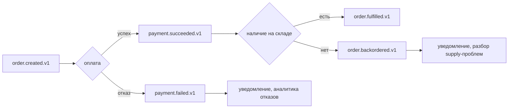

# events

Контракты асинхронных событий в формате JSON Schema (draft 2020-12).

⚠️ **Ни одна из описанных здесь схем не используется.** Все они относятся к `order-service`, которого в системе нет. Единственный работающий поток событий — `catalog.products.v1` — в этом каталоге не описан. Подробнее в разделе «Расхождение с реальностью».

```text
events/
├── common-envelope.v1.json     # общий каркас
├── order.created.v1.json
├── payment.succeeded.v1.json
├── payment.failed.v1.json
├── order.fulfilled.v1.json
└── order.backordered.v1.json
```

## Общий каркас

[`common-envelope.v1.json`](common-envelope.v1.json) описывает поля, обязательные для любого события:

| Поле | Тип | Обяз. | Назначение |
|---|---|:---:|---|
| `event_id` | uuid | ✅ | Идемпотентность у потребителя, корреляция в логах |
| `event_type` | `^[a-z]+\.[a-z]+$` | ✅ | Диспетчеризация без разбора тела |
| `event_version` | `const: 1` | ✅ | Эволюция схемы |
| `occurred_at` | date-time | ✅ | Время события у издателя, не время доставки |
| `order_id` | uuid | ✅ | Ключ агрегата и ключ партиционирования Kafka |
| `customer_id` | uuid | — | |
| `data` | object | ✅ | Полезная нагрузка, специфичная для типа события |

`additionalProperties: false` запрещает поля вне схемы — жёсткое требование, которое ловит опечатки в именах полей на этапе валидации, но одновременно делает любое добавление поля изменением схемы.

**Почему `event_id` обязателен.** Брокеры дают at-least-once: дубликаты неизбежны. Без стабильного идентификатора потребитель не может отличить повтор от нового события. В проекте этот приём реализован в [`shop-cart`](../../shop-cart/internal/repository/mongodb) (коллекция `processed_events` с `_id = event_id`) и в [`shop-search`](../../shop-search/internal/search) (документ под `_id = product_id`).

**Почему `occurred_at`, а не `sent_at`.** Момент, когда факт случился, не совпадает с моментом доставки — особенно при работе через outbox, где между записью и публикацией проходит до секунды, а при сбое брокера и больше. Потребитель, которому важен порядок, должен опираться на `occurred_at`.

**Контейнер `data`.** Общие поля лежат на верхнем уровне, специфичные — внутри `data`. Это позволяет потребителю разобрать конверт, не зная конкретного типа события: например, отправить в DLQ или залогировать, не имея схемы полезной нагрузки.

## Правила v1

* **Имя топика:** `<event_name>.v1` — версия в имени топика, а не только в поле. При переходе на `v2` создаётся новый топик, и потребители миграции идут своим темпом.
* **Ключ Kafka:** `order_id` — все события одного заказа попадают в одну партицию и сохраняют порядок.
* **Обязательные заголовки:** `traceparent`, `x-request-id`, `event_type`, `event_version`.
* **Совместимость:** обратно совместимые изменения допустимы в `v1`, ломающие — только через `v2`.

`traceparent` в заголовках (формат W3C Trace Context) — то, что позволяет трейсу не рваться на границе брокера: потребитель восстанавливает контекст и его спаны становятся дочерними к спану издателя.

`event_type` и `event_version` дублируются в заголовках намеренно — потребитель может отфильтровать или смаршрутизировать сообщение, не десериализуя тело.

## Поток checkout



| Событие | Кто публикует | Кто потребляет |
|---|---|---|
| `order.created.v1` | order-service | payment, audit |
| `payment.succeeded.v1` | payment | fulfillment, notification |
| `payment.failed.v1` | payment | notification, аналитика |
| `order.fulfilled.v1` | fulfillment | notification, audit |
| `order.backordered.v1` | fulfillment | notification |

`payment.failed.v1` различает причины отказа: `declined`, `timeout`, `provider_error`, `invalid_request` — по ним строится аналитика, а не только уведомления.

## Валидация

```bash
make validate-events
```

Компилирует каждую схему через `ajv` с подключённым `common-envelope.v1.json` как справочной. Проверяется корректность самих схем, а не соответствие им реальных сообщений — валидации сообщений в рантайме нигде нет.

---

## Расхождение с реальностью

Это главное, что нужно знать об этом каталоге.

**Описанные события не публикуются.** `order-service` не существует: есть только [`order.proto`](../proto/order/v1/order.proto) и эти пять схем. Соответственно нет ни `payment`, ни `fulfillment`. [`shop-notification`](../../shop-notification) привязывает свою очередь к ключу `order.#` и ждёт эти события — и не получает ничего.

**Работающие события не описаны.** Каталог публикует `catalog.products.v1` (потребители — [`shop-cart`](../../shop-cart/internal/events) и [`shop-search`](../../shop-search/internal/events)), но схемы для него здесь нет, а его формат несовместим с конвертом:

| Требует `common-envelope.v1.json` | Фактически публикует каталог |
|---|---|
| `event_id` | ✅ есть |
| `event_type` | ✅ есть (`product.created`, `stock.changed`) |
| `event_version: 1` | ❌ отсутствует |
| `occurred_at` | ❌ называется `occured_at` (опечатка) |
| `order_id` (uuid, обязателен) | ❌ отсутствует — у события товара нет заказа |
| контейнер `data` | ❌ плоская структура |
| `additionalProperties: false` | ❌ `product_id`, `sku`, `name`, `price_cents`… вне схемы |
| заголовок `traceparent` | ❌ отсутствует |
| заголовки `event_type`, `event_version` | ❌ вместо них `event-type`, `event-id`, `source` |

Обязательный `order_id` показывает, что конверт проектировался под одну предметную область — заказы — и не годится для событий других агрегатов. Разумный шаг: обобщить каркас, заменив `order_id` на необязательный `aggregate_id` + `aggregate_type`, и описать `catalog.products.v1` отдельной схемой.

**Ключ партиционирования расходится.** Правило предписывает `order_id`, каталог использует `product_id` — и для событий товара это правильно, поскольку порядок нужен именно в пределах товара. Правило должно говорить «ключ агрегата», а не «`order_id`».

**Схема события — не в контрактах, а в коде.** Структура `ProductEvent` объявлена в трёх сервисах независимо. Это ровно тот класс проблем, для устранения которого репозиторий контрактов и существует: расхождение копий не обнаружится ни компилятором, ни тестами — только отсутствием данных в поисковом индексе.

## Известные проблемы

1. **`catalog.products.v1` не описан** — единственный работающий поток событий вне контрактов.
2. **Конверт не подходит для событий товара** из-за обязательного `order_id`.
3. **Опечатка `occured_at`** в реальном формате (контракт требует `occurred_at`). Исправление требует одновременной правки в каталоге, корзине и поиске — иначе поле перестанет разбираться.
4. **Заголовки в коде не соответствуют правилам**, включая отсутствие `traceparent`.
5. **Нет валидации сообщений в рантайме.** Схемы компилируются в CI, но ни издатель, ни потребитель не проверяют по ним фактические сообщения.
6. **Пять схем без реализации** описывают несуществующую часть системы, создавая впечатление готовой саги заказа.
